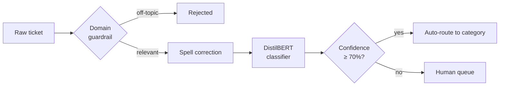
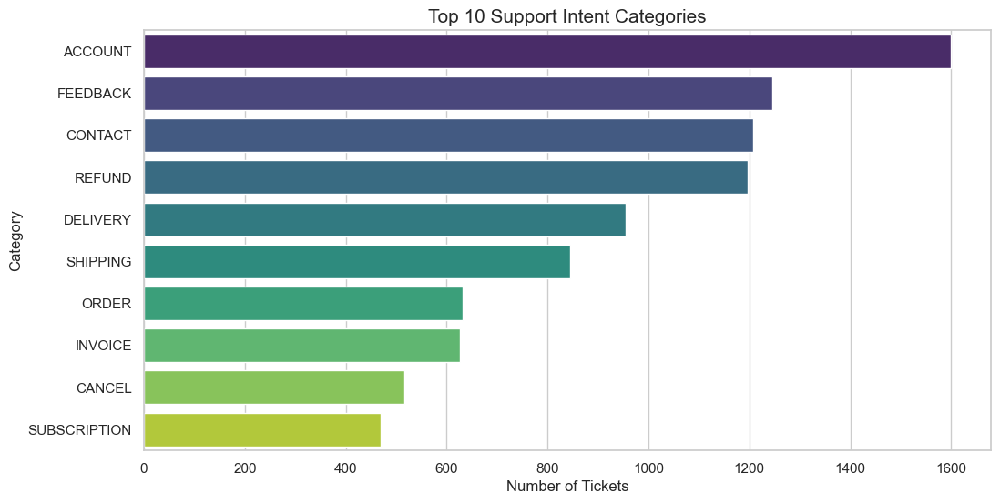
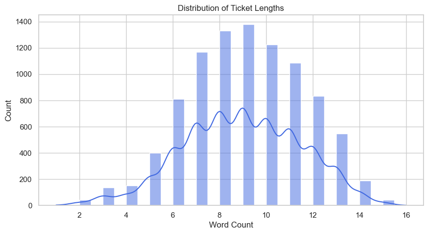
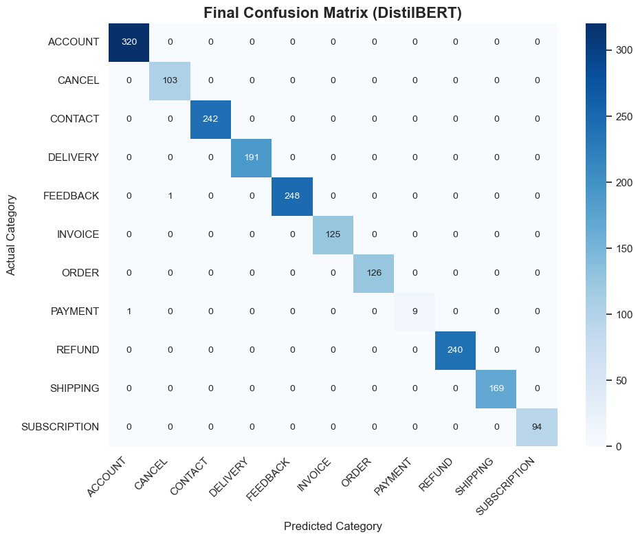

# Auto-Triage — Customer Support Ticket Classification

An end-to-end NLP project that reads a customer-support ticket and routes it to the
right department — or admits it is unsure and sends it to a human instead.

Built for the **Text Classification (CAA1C14)** module.


---

## Contents

- [What it does](#what-it-does)
- [Results](#results)
- [Dataset](#dataset)
- [Method](#method)
- [Getting started](#getting-started)
- [Repository structure](#repository-structure)
- [Model](#model)
- [Limitations](#limitations)
- [Data and ethics](#data-and-ethics)
- [Licence](#licence)

---

## What it does

A support ticket arrives as free text — *"My login passwrd is broken."* The system
decides which of **11 support categories** it belongs to (ACCOUNT, CANCEL, CONTACT,
DELIVERY, FEEDBACK, INVOICE, ORDER, PAYMENT, REFUND, SHIPPING, SUBSCRIPTION) and how
confident it is.

Three things sit in front of the classifier so it fails safely:

1. **Domain guardrail** — if the ticket contains no e-commerce vocabulary at all, it is
   rejected as off-topic before the model runs.
2. **Spell correction** — typos are repaired so *"passwrd"* is not treated as an unknown word.
3. **Confidence threshold** — below **70 %** confidence the ticket goes to a human queue
   rather than being auto-routed to the wrong team.



Example run from the notebook:

| Input | Corrected | Route | Confidence |
|---|---|---|---|
| `Where is my package?` | — | ✅ DELIVERY | 74.84 % |
| `My login passwrd is broken.` | `My login password is broken` | ✅ ACCOUNT | 99.78 % |
| `I want to rturn my damaged item.` | `I want to turn my damaged item` | ⚠️ Human queue | 59.01 % |
| `How is the weather?` | — | ⛔ Off-topic | — |
| `This is a Text Classification module.` | — | ⛔ Off-topic | — |
| `I heve a qustien abut the order bt FeelsBadMan.` | `I have a question abut the order bt FeelsBadMan.` | ⚠️ Human queue | 41.12 % |

---

## Results

Both models were trained on the same stratified 80/20 split
(**7,474 train / 1,869 test** tickets, `random_state=7204`).

| Model | Test accuracy | Macro F1 | Weighted F1 |
|---|---|---|---|
| TF-IDF + Linear SVM (baseline) | ≈ 99.7 % ¹ | 0.98 | 1.00 |
| **DistilBERT (fine-tuned)** | **99.89 %** | **0.99** | **1.00** |

¹ scikit-learn prints both accuracies as `1.00` at two decimal places; the SVM's true
score is recovered from its per-class recalls, and its 0.98 macro F1 is driven almost
entirely by PAYMENT (4 of 10 missed). DistilBERT's 2 errors are visible in the
[confusion matrix](#confusion-matrix-distilbert).

Per-category F1 on the test set:

| Category | Test support | SVM F1 | DistilBERT F1 |
|---|---:|---:|---:|
| ACCOUNT | 320 | 0.99 | 1.00 |
| CANCEL | 103 | 1.00 | 1.00 |
| CONTACT | 242 | 1.00 | 1.00 |
| DELIVERY | 191 | 0.99 | 1.00 |
| FEEDBACK | 249 | 1.00 | 1.00 |
| INVOICE | 125 | 1.00 | 1.00 |
| ORDER | 126 | 0.99 | 1.00 |
| PAYMENT | 10 | 0.75 | 0.95 |
| REFUND | 240 | 1.00 | 1.00 |
| SHIPPING | 169 | 1.00 | 1.00 |
| SUBSCRIPTION | 94 | 1.00 | 1.00 |

DistilBERT training curve (early-stopped at epoch 6 of 10):

| Epoch | Train loss | Val loss | Accuracy | Weighted F1 |
|---:|---:|---:|---:|---:|
| 1 | 0.1000 | 0.0486 | 0.9936 | 0.9909 |
| 2 | 0.0202 | 0.0149 | 0.9984 | 0.9983 |
| 3 | 0.0049 | 0.0105 | 0.9989 | 0.9989 |
| 4 | 0.0033 | 0.0104 | 0.9989 | 0.9989 |
| 5 | 0.0023 | 0.0090 | 0.9989 | 0.9989 |
| 6 | 0.0017 | 0.0079 | 0.9989 | 0.9989 |

### Class distribution

After cleaning (9,343 tickets):



### Ticket length

Mean length is 8.97 words, so the 512-token limit of DistilBERT is never a constraint here.



### Confusion matrix (DistilBERT)

Only two test tickets are misclassified: one PAYMENT ticket predicted as ACCOUNT, and
one FEEDBACK ticket predicted as CANCEL.



> ⚠️ These numbers are high on purpose — see [Limitations](#limitations) before quoting
> them as real-world performance.

---

## Dataset

[`dataset/customer_support_data.csv`](dataset/customer_support_data.csv) — 26,872 synthetic
customer-support tickets, downloaded from the Hugging Face Hub:

> [`bitext/Bitext-customer-support-llm-chatbot-training-dataset`](https://huggingface.co/datasets/bitext/Bitext-customer-support-llm-chatbot-training-dataset)

| Column | Description |
|---|---|
| `flags` | Two-to-four letter paraphrase marker used by the dataset authors |
| `instruction` | The customer's message — the model input |
| `category` | Top-level support category (11 values) — the target label |
| `intent` | Fine-grained intent (27 values), not used for training |
| `response` | A reference agent reply, not used for training |

The data is generated from templates with placeholders such as `{{Order Number}}`. It
contains **no real customer records**, emails or identifiers.

The dataset is licensed **CDLA-Sharing-1.0** — see [`dataset/README.md`](dataset/README.md)
and [`dataset/LICENSE-CDLA-Sharing-1.0.md`](dataset/LICENSE-CDLA-Sharing-1.0.md).

---

## Method

### 1. Cleaning and leakage control

`load_and_clean_data()` renames columns, drops nulls, and removes duplicated columns.
Two further filters matter a lot:

- **"Culprit" removal.** If the category name itself appears in the ticket text
  (category `REFUND`, text *"I want a refund"*), the row is dropped — otherwise the model
  can score highly by matching the answer word instead of learning the phrasing.
  This removes **14,162 rows (53 %)**.
- **Duplicate removal** on the cleaned text removes another 3,367 rows.

That leaves **9,343** tickets used for training and evaluation.

### 2. Baseline — TF-IDF + Linear SVM

Text is lower-cased, stripped of punctuation, stop-words and polite filler
(*"please"*, *"hello"*, …), lemmatised with NLTK, and the words are sorted so that word
order does not affect the bag-of-words comparison. A `TfidfVectorizer`
(5,000 features, unigrams + bigrams) feeds a `LinearSVC`, with the regularisation
strength `C` chosen by 3-fold `GridSearchCV` (best: `C = 10`).

### 3. DistilBERT

`distilbert-base-uncased` is fine-tuned with the Hugging Face `Trainer`:

| Setting | Value |
|---|---|
| Epochs | 10 (early stopping, patience 3) |
| Batch size | 32 |
| Learning rate | 2e-5 |
| Weight decay | 0.01 |
| Mixed precision | FP16 |
| Checkpoints kept | 2 (`save_total_limit`) |
| Best-model metric | weighted F1 |

### 4. Inference layer

`smart_predict()` runs the guardrail → spell correction → DistilBERT → softmax →
threshold, and returns `(route, confidence, corrected_text)`.

---

## Getting started

```bash
git clone <your-repo-url>
cd auto_triage

python -m venv .venv
# Windows
.venv\Scripts\activate
# macOS / Linux
source .venv/bin/activate

pip install -r requirements.txt
jupyter lab auto_triage_model.ipynb
```

Run the cells from top to bottom. Training writes two folders that are **not** committed:

- `distilbert-base-uncased-finetuned/` — trainer checkpoints (they were ~1.6 GB, mostly optimiser state)
- `my_support_model/` — the saved model used for inference (~268 MB)

### GPU

The reference run used an NVIDIA GTX 1660 Ti (6 GB) with CUDA 12.1 and took about
15–20 minutes for the fine-tuning. On CPU everything still works, just slower — expect
roughly an hour. If you need the CUDA build of PyTorch, install it first:

```bash
pip install torch==2.5.1 --index-url https://download.pytorch.org/whl/cu121
```

Then `pip install -r requirements.txt` will see the pinned version is already satisfied.

### Verified environment

| | |
|---|---|
| Python | 3.11.14 |
| PyTorch | 2.5.1+cu121 |
| Transformers | 5.0.0 |
| GPU | NVIDIA GeForce GTX 1660 Ti |
| OS | Windows 11 |

> **These pins are deliberate.** This is a frozen coursework artefact: the figures in
> [Results](#results) were produced with exactly these versions, so `requirements.txt` is
> not bumped to newer ones. Dependabot advisories that do not touch code this project
> actually runs are dismissed as *tolerable risk* for the same reason.

---

## Repository structure

```
auto_triage/
├── auto_triage_model.ipynb            # the whole project: EDA → SVM → DistilBERT → demo
├── requirements.txt
├── README.md
├── LICENSE                            # MIT (code and report)
├── dataset/
│   ├── customer_support_data.csv      # 26,872 tickets (~19 MB)
│   ├── README.md                      # provenance, fields, licence
│   └── LICENSE-CDLA-Sharing-1.0.md    # licence of the data
└── docs/
    └── images/                        # figures exported from the notebook
```

---

## Model

The trained weights (268 MB) are **not** in this repository — GitHub rejects files over
100 MB, and a fine-tuned DistilBERT is regenerated more cheaply than it is stored.

To rebuild it, run the notebook top to bottom; the last training cell writes
`my_support_model/` containing `config.json`, `model.safetensors`, `tokenizer.json`,
`tokenizer_config.json` and `training_args.bin`.

To use it:

```python
from transformers import pipeline

clf = pipeline(
    "text-classification",
    model="my_support_model",       # path produced by the notebook
    tokenizer="my_support_model",
)
print(clf("My login password is broken"))
# [{'label': 'ACCOUNT', 'score': 0.9978...}]
```

---

## Limitations

These results should be read as *"the pipeline works end to end"*, not as
*"99.9 % accurate in production"*:

- **The data is synthetic.** The Bitext dataset is generated from templates and
  paraphrases. Real tickets are longer, messier, multilingual, and full of names, order
  numbers and quoted e-mails. Accuracy on real traffic would be far lower.
- **Leakage filtering makes the task easier.** Removing every ticket whose text contains
  its own category word removed 53 % of the data and the easiest signal with it. This is
  deliberate and honest, but it means the reported score is not comparable to papers that
  train on the raw data.
- **PAYMENT is tiny.** Its test split has 10 examples, so 0.90 recall is 9 out of 10 — a
  very wide confidence interval.
- **The guardrail is a hand-written keyword list.** It is brittle: it blocks a genuine
  ticket that happens to avoid every keyword, and lets through nonsense that contains one
  (`"order bt FeelsBadMan"` passes it).
- **The 70 % threshold was chosen by inspection,** not tuned on a validation split. And
  softmax confidence is not a calibrated probability — a model can be confidently wrong.
- **English, single domain, 11 categories.** Nothing here handles code-switching,
  attachments, or a ticket that spans two categories.

---

## Data and ethics

- The dataset is **synthetic**; it contains no real customer messages, e-mail addresses,
  phone numbers or account details.
- Tickets are classified into coarse support categories only. No sentiment profile,
  no customer scoring, and nothing is stored — this is a coursework prototype.
- The trained model is not deployed anywhere and makes no decisions about real people.

---

## Licence

- **Code and report in this repository:** [MIT](LICENSE)
- **Dataset:** [CDLA-Sharing-1.0](dataset/LICENSE-CDLA-Sharing-1.0.md), © Bitext
- **`distilbert-base-uncased`:** Apache-2.0, © Hugging Face

---

## Acknowledgements

- [Bitext](https://www.bitext.com/) for the customer-support dataset
- [Hugging Face](https://huggingface.co/) for `transformers`, `datasets` and `accelerate`
- Sanh et al., *DistilBERT, a distilled version of BERT* (2019)
